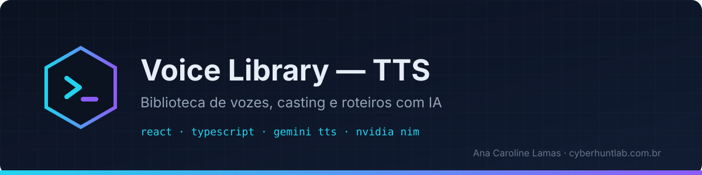

<p align="center"></p>

# Voice Library — biblioteca de vozes TTS, casting com IA e roteiros narrativos

Aplicação web em **React + TypeScript** para **explorar, ouvir e escolher vozes de síntese de fala (TTS)**. Ela recomenda vozes a partir de uma descrição (casting com IA) e gera **roteiros narrativos de 60 a 90 segundos em português do Brasil**, que podem ser ouvidos na voz escolhida. Usa o **Google Gemini** para texto e áudio e, opcionalmente, a **NVIDIA NIM** (Llama 3.3 70B) para os roteiros.

## Recursos

- **Biblioteca de vozes** em carrossel 3D ou grade, com reprodução e visualizador de áudio em tempo real.
- **Casting com IA**: descreva tom, emoção, gênero ou projeto e receba as vozes mais adequadas.
- **Estúdio de roteiros**: narrativas e histórias cronometradas para 60 a 90 segundos de locução em PT-BR, com prévia em áudio.
- **Filtros** por gênero, tom (grave, médio, agudo) e busca instantânea.
- **Dois provedores**: Gemini (roteiros, casting e TTS) e NVIDIA NIM (roteiros), com chaves configuráveis na interface.
- **Tema claro/escuro** e layout responsivo.

## Instalação

Requisitos: **Node.js 18+** e uma chave da API do **Gemini**.

```bash
git clone https://github.com/ticarollamas-arch/Tts-Audio.git
cd Tts-Audio
npm install
cp .env.example .env      # GEMINI_API_KEY (também pode ser informada na interface)
```

A chave da NVIDIA NIM é opcional e é cadastrada pelo botão **API** no cabeçalho.

## Como usar

```bash
npm run dev       # http://localhost:3000
npm run build     # build de produção
npm run preview
```

1. Navegue pelas vozes e ouça as amostras.
2. Use o casting com IA para receber recomendações.
3. Abra o estúdio, gere um roteiro e ouça a narração na voz escolhida.

> As chaves informadas na interface ficam no navegador. Em produção, prefira um backend para proteger as credenciais.

## Tecnologias

React 19 · TypeScript · Vite · Tailwind CSS · Framer Motion · react-markdown · lucide-react · Google Gemini (`@google/genai`) · NVIDIA NIM

## Licença

Distribuído sob a licença MIT. Veja [LICENSE](LICENSE).
